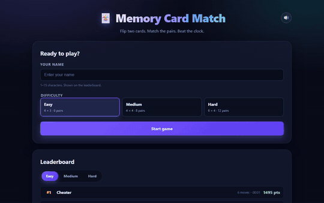

# Memory Card Match


A complete, full-stack **Memory Card Match** game:

- **Frontend** – plain HTML + CSS + vanilla JavaScript (no frameworks, no build step)
- **Backend** – Node.js + Express REST API
- **Database** – SQLite via `better-sqlite3`

Flip two cards at a time. Matching pairs stay open, mismatches flip back.
Three difficulties, a timer, a move counter, personal bests and an online leaderboard.

---

## Project overview

| | |
| --- | --- |
| **Project** | Memory Card Match — a full-stack card matching game with a leaderboard |
| **Playable game** | Run `npm install && npm start`, then open <http://localhost:3000> |
| **Repository** | <https://github.com/OWNER/memory-game> |
| **Demo video** | [`docs/demo.mp4`](docs/demo.mp4) — 25 second screen recording of a full game (H.264, 960×600) |
| **Demo animation** | [`docs/demo.gif`](docs/demo.gif) — the same recording as a lightweight GIF |
| **Live demo** | <https://OWNER.github.io/memory-game/> (if published) |

### Demo



The recording shows a complete Medium game: the name and difficulty are filled
in, all 16 cards are revealed, every pair is matched, the win screen appears
with the score, and the score is saved to the leaderboard.

> The demo is generated automatically — `npm start` in one terminal, then
> `node scripts/record-demo.js` (needs Chrome and ffmpeg) re-records
> `docs/demo.mp4` and `docs/demo.gif`.

### What it does

- Three difficulties — Easy (4×3), Medium (4×4), Hard (6×4) — with a live timer,
  move counter, pause and restart.
- Server-side scoring: fewer moves and less time always mean a higher score, and
  harder difficulties are worth more.
- An online leaderboard (top 10 per difficulty) plus per-difficulty personal
  bests stored in the browser.
- Synthesised sound effects and a confetti celebration — no media assets needed.
- Fully playable **without the backend**: the game degrades gracefully when the
  API is down.
- Keyboard accessible end to end and safe against XSS.

### My role

I designed and built the **entire project end to end**, on my own:

- **Game design** — the rules, the three difficulty tiers and the score formula
  (perfect-play bonus, move penalty, time factor, per-difficulty multiplier).
- **Backend** — the Express API, the SQLite schema, input validation and the
  anti-cheat rules that keep the leaderboard honest, rate limiting and the
  security headers.
- **Frontend** — the screens, the 3D card-flip animation, the timer, the sound
  engine, the confetti canvas, the accessibility layer and the responsive,
  reduced-motion-aware design.
- **Quality** — the 62 automated checks, the ESLint setup and the CI pipeline.

### Tools & technologies used

| Layer | Tool |
| --- | --- |
| Language | JavaScript (ES2023), HTML5, CSS3 |
| Runtime | Node.js ≥ 18 (developed on Node 25) |
| Server | Express 4, `cors`, `express-rate-limit` |
| Database | SQLite via `better-sqlite3` (prepared statements) |
| Frontend | Vanilla JavaScript — no framework, no bundler, no build step |
| Audio | Web Audio API (synthesised sound effects) |
| Graphics | CSS 3D transforms, HTML Canvas (confetti) |
| Testing | Node built-in test runner style scripts + Chrome DevTools Protocol (headless Chrome) |
| Linting | ESLint 10 (flat config, separate Node and browser environments) |
| CI/CD | GitHub Actions, Dependabot |
| Tooling | Git, npm, `.editorconfig`, `.gitattributes` |

---

## Quick start

```bash
cd memory-game
npm install
npm start
```

Then open **<http://localhost:3000>** in your browser.

Useful commands:

| Command | Description |
| --- | --- |
| `npm start` | Start the server on port 3000 |
| `npm run dev` | Start the server with `node --watch` (auto-restart) |
| `npm run lint` | Run ESLint over the whole project |
| `npm run lint:fix` | Run ESLint and auto-fix what it can |
| `npm test` | API smoke test (valid **and** invalid requests for every endpoint) |
| `npm run test:browser` | End-to-end frontend test in headless Chrome (CDP) |
| `npm run test:resilience` | Keyboard play + "API is down" behaviour, headless Chrome |
| `npm run test:all` | Lint + all three suites (the server must be running) |
| `node scripts/record-demo.js` | Re-record the gameplay demo into `docs/` (needs Chrome + ffmpeg) |
| `PORT=4000 npm start` | Start on a different port |

The SQLite database is created automatically at `backend/data/memory.db` on first run.

> **Windows note:** if PowerShell blocks `npm`, use `npm.cmd` instead of `npm`.

### What the tests cover

`npm test` — every endpoint with a valid **and** an invalid payload: missing
name, 16-character name, unknown difficulty, impossible moves, absurd move
counts, negative/implausible durations, non-numeric fields, malformed JSON,
missing query parameter, unknown API route, and a client-supplied `score`
that must be ignored.

`npm run test:browser` — drives the real page in headless Chrome: form
validation, board rendering, move counting, match/mismatch behaviour, the
pause overlay, the win screen and saving a score.

`npm run test:resilience` — verifies **Tab/Enter/Space** keyboard play and
that the game stays fully playable when every `/api/*` request is blocked.

The browser tests need Chrome, Chromium or Edge. They look for a browser on
Windows, macOS and Linux and can be pointed at a specific binary with the
`CHROME_PATH` environment variable; if no browser is found the suite is
skipped instead of failing.


---

## Project structure

```
memory-game/
├── .github/
│   ├── workflows/
│   │   ├── ci.yml           # Lint + API + browser tests on Node 18/20/22
│   │   └── release.yml      # Tag-based GitHub release
│   ├── ISSUE_TEMPLATE/      # Bug report, feature request, config
│   ├── dependabot.yml       # npm + GitHub Actions updates
│   └── PULL_REQUEST_TEMPLATE.md
├── backend/
│   ├── server.js          # Express app: middleware, routes, static hosting, errors
│   ├── db.js              # SQLite connection, schema, queries
│   ├── scoring.js         # The score formula (server-side, single source of truth)
│   ├── validate.js        # Input validation + anti-cheat rules
│   ├── routes/
│   │   ├── scores.js      # POST /api/scores, GET /api/scores, GET /api/scores/config
│   │   └── stats.js       # GET /api/stats
│   └── data/              # SQLite file lives here (git-ignored)
├── docs/
│   ├── demo.mp4             # Screen recording of a full game
│   └── demo.gif             # The same recording as a GIF
├── frontend/
│   ├── index.html         # Start / game / win screens, leaderboard, HUD
│   ├── style.css          # Dark theme, 3D card flip, glow & shake animations
│   ├── game.js            # Game logic, timer, scoring preview, leaderboard, a11y
│   ├── sound.js           # Web Audio sound effects (no audio files needed)
│   └── confetti.js        # Canvas celebration for the win screen
├── scripts/
│   ├── test-api.js        # API smoke test (valid + invalid requests)
│   ├── browser-test.js    # End-to-end frontend test (headless Chrome, CDP)
│   ├── resilience-test.js # Keyboard play + "API is down" behaviour
│   └── record-demo.js     # Records the gameplay demo (Chrome + ffmpeg)
├── eslint.config.mjs     # ESLint 10 flat config (Node + browser environments)
├── CHANGELOG.md
├── CONTRIBUTING.md
├── LICENSE
├── SECURITY.md
├── package.json
├── README.md
└── .gitignore
```

---

## Game rules

| Difficulty | Board | Pairs | Minimum possible moves |
| --- | --- | --- | --- |
| Easy | 4 × 3 | 6 | 6 |
| Medium | 4 × 4 | 8 | 8 |
| Hard | 6 × 4 | 12 | 12 |

- Card faces: 🍎 🐶 🚀 ⚽ 🎸 🌈 🍕 🦋 🔥 🎲 🌙 🍩
- A **move** is one pair of cards being flipped (the second card of a turn).
- Matched pairs stay face-up and glow green.
- Mismatched pairs shake gently and flip back down.
- The timer starts on the first flip and stops when the last pair is found.
- The game can be paused and restarted at any time; personal bests are stored
  per difficulty in the browser's `localStorage`.

### Sound & celebration

- Every event has a short synthesised sound effect (card flip, match, mismatch,
  win fanfare, error buzz). They are generated with the **Web Audio API** —
  there are no audio files to download, so they work offline too.
- The 🔊 button in the header mutes and unmutes everything. The choice is
  remembered in `localStorage` and survives a reload.
- Winning fires a canvas **confetti** celebration that never blocks clicks
  and is skipped (or heavily reduced) for users who enabled
  `prefers-reduced-motion`.

---

## Scoring formula

The score is **always computed by the server**. The client never sends a score —
the API payload only contains `name`, `difficulty`, `moves` and `timeSeconds`.

Defined in `backend/scoring.js`:

```
raw   = base
      + perfectBonus            (only when moves === pairs)
      - movePenalty * (moves - pairs)
      - timeFactor  * timeSeconds

score = max(0, round(raw * multiplier))
```

| Difficulty | base | perfectBonus | movePenalty | timeFactor | multiplier |
| --- | --- | --- | --- | --- | --- |
| Easy | 1000 | 500 | 25 | 5 | 1.00 |
| Medium | 1500 | 800 | 30 | 6 | 1.25 |
| Hard | 2000 | 1200 | 35 | 7 | 1.50 |

So **fewer moves and less time always mean a higher score**, and harder
difficulties are worth more points.

The frontend mirrors this formula only to display a *preview* while playing
(`previewScore()` in `frontend/game.js`); after saving, the authoritative
server value replaces the preview. `GET /api/scores/config` lets the frontend
keep its preview in sync with the server configuration.

---

## REST API

All responses are JSON. Errors look like `{ "ok": false, "error": "..." }`.

### `GET /api/health`

```json
{ "ok": true, "status": "healthy", "uptimeSeconds": 42, "timestamp": "2026-01-01T00:00:00.000Z" }
```

### `POST /api/scores`

Body:

```json
{ "name": "Ada", "difficulty": "easy", "moves": 9, "timeSeconds": 42 }
```

- `name` — string, 1–15 characters (control characters are stripped)
- `difficulty` — `easy` | `medium` | `hard`
- `moves` — integer ≥ the number of pairs (anti-cheat) and ≤ `pairs × 4`
- `timeSeconds` — integer, 0 … 7200

`201 Created`:

```json
{
  "ok": true,
  "score": { "id": 1, "name": "Ada", "difficulty": "easy", "moves": 9, "timeSeconds": 42, "score": 1155, "createdAt": "2026-01-01 00:00:00" }
}
```

Errors: `400` invalid/impossible payload, `429` rate limit exceeded.

**Rate limit:** 30 score submissions per minute per IP (`express-rate-limit`).
Only `POST /api/scores` is limited — reading the leaderboard never is.

### `GET /api/scores?difficulty=easy`

Returns the top 10 entries for a difficulty, best score first (ties broken by
fastest time, then by submission order).

```json
{ "ok": true, "difficulty": "easy", "limit": 10, "scores": [ { "id": 1, "name": "Ada", "moves": 9, "timeSeconds": 42, "score": 1155, "createdAt": "..." } ] }
```

### `GET /api/scores/config`

Public scoring configuration (difficulty parameters) used by the frontend for
the score preview.

### `GET /api/stats`

```json
{ "ok": true, "totalGames": 12, "averageScore": 980, "bestScore": 2100, "byDifficulty": [ { "difficulty": "easy", "totalGames": 8, "averageScore": 900, "bestScore": 1400 } ] }
```

---

## Anti-cheat

The server never trusts the client:

1. **The score is computed server-side** — the request body cannot contain one.
2. **Impossible move counts are rejected** — fewer moves than pairs is
   physically impossible, and absurdly high counts are refused as well.
3. **Implausible durations are rejected** (negative or > 2 hours).
4. **Names are sanitised** — trimmed, control characters removed, max 15 chars.
5. **Rate limiting** protects the leaderboard from spam.
6. **Payload size is capped** (`16kb`) and malformed JSON returns a clean `400`.

---

## Accessibility & UX

- Every card is a real `<button>`: **Tab** to move, **Enter** or **Space** to flip.
- The leaderboard tabs follow the WAI-ARIA tabs pattern (**←/→** to switch).
- Focus is moved to the board when a game starts and to the *Save Score*
  button on the win screen.
- Live regions (`aria-live`) announce leaderboard and save-status updates.
- Player names are rendered with `textContent` only — **never** `innerHTML` —
  so a hostile name can never inject markup (**XSS-safe**).
- Responsive from ~320 px phones to wide desktops; honours
  `prefers-reduced-motion`.

---

## Graceful degradation

The game is fully playable **without the backend**:

- If the API is down, the leaderboard shows a friendly message, the stats bar
  hides itself, and *Save Score* reports the error — but the game itself,
  the timer, the matching logic and the personal best keep working.
- If the frontend is opened directly from disk (`file://`), the API calls
  automatically fall back to `http://localhost:3000`.

---

## Security

The server sends a strict set of security headers on every response
(`nosniff`, `X-Frame-Options: DENY`, `Referrer-Policy: no-referrer` and a
`Content-Security-Policy` that only allows same-origin scripts and styles).
The score is always computed on the server, inputs are validated and
sanitised, and all SQL statements are parameterised.

Please **do not** open a public issue for a security problem — report it
privately as described in [SECURITY.md](SECURITY.md).

---

## Contributing

Bug reports, ideas and pull requests are welcome. Please read
[CONTRIBUTING.md](CONTRIBUTING.md) first — it covers the code style, the commit
convention, how to add a new difficulty and how to run the test suite.

## Changelog

Notable changes are listed in [CHANGELOG.md](CHANGELOG.md), which follows
[Keep a Changelog](https://keepachangelog.com/en/1.1.0/) and
[Semantic Versioning](https://semver.org/spec/v2.0.0.html).

## License

Released under the [MIT License](LICENSE). © 2026 Prathamesh Kalange.

